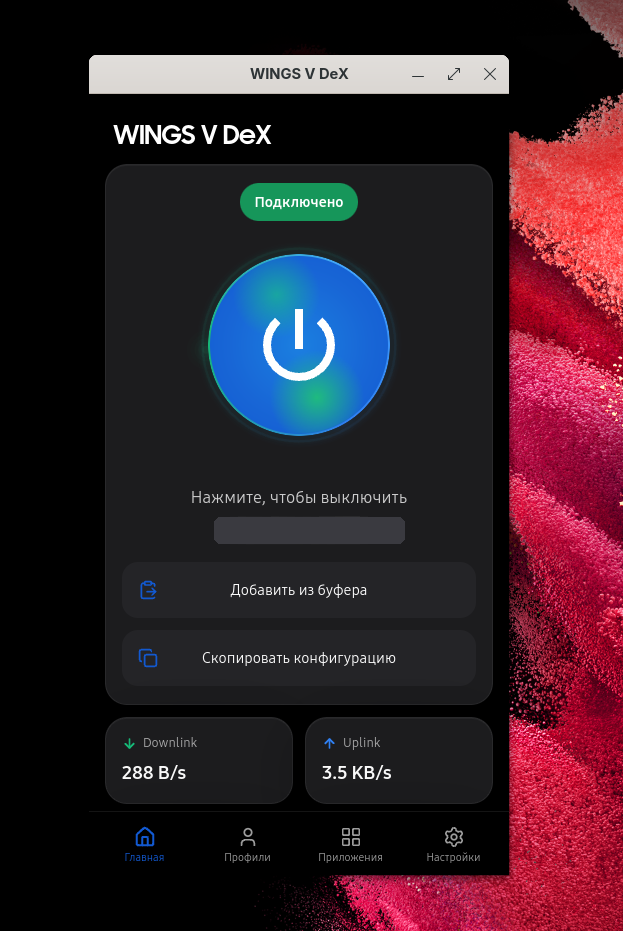
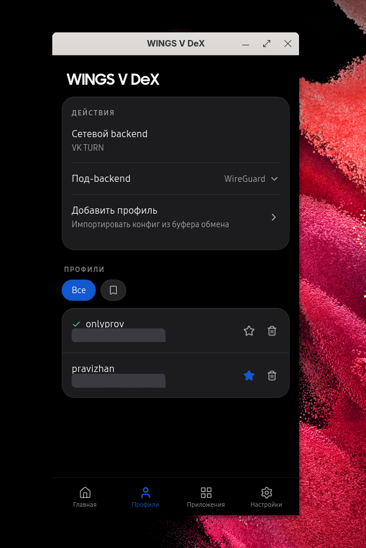
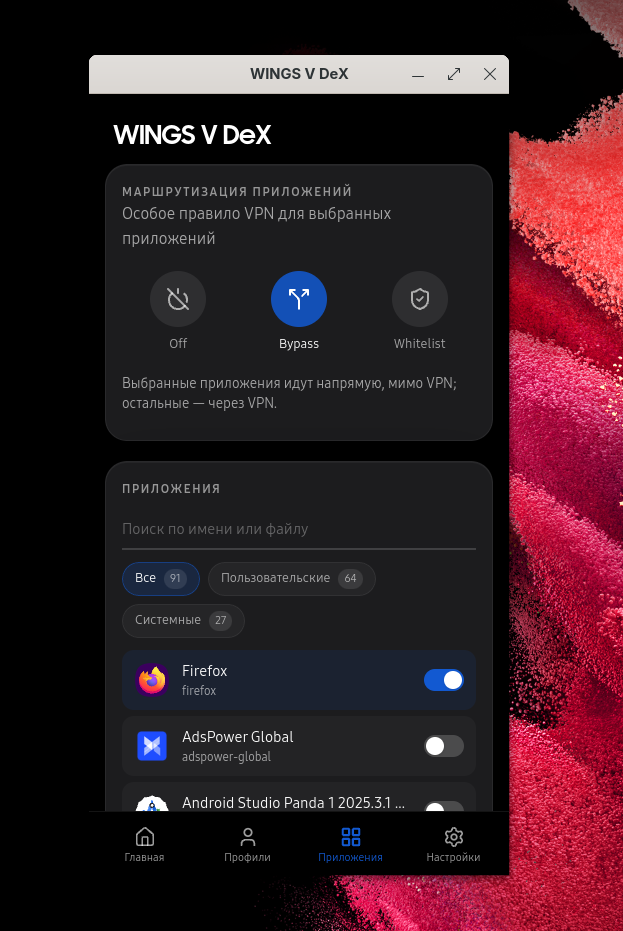
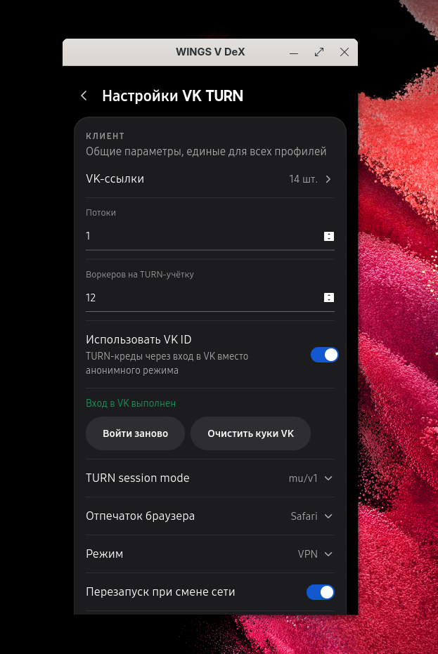
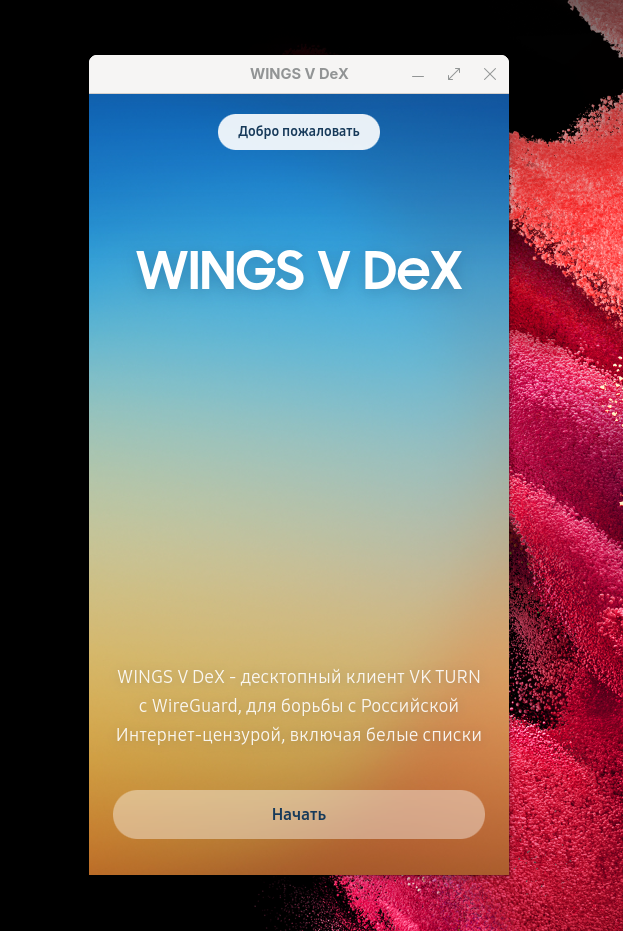
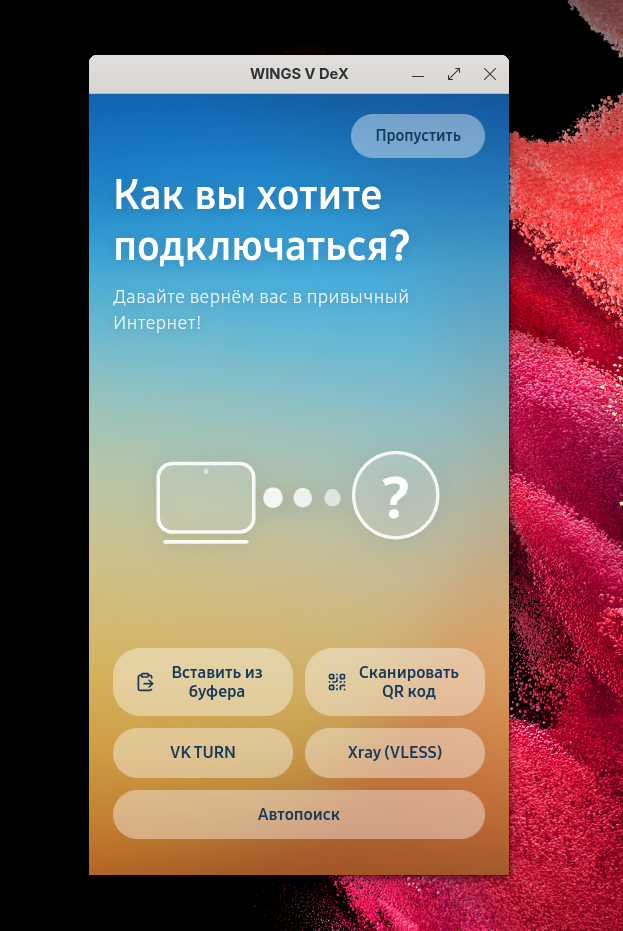
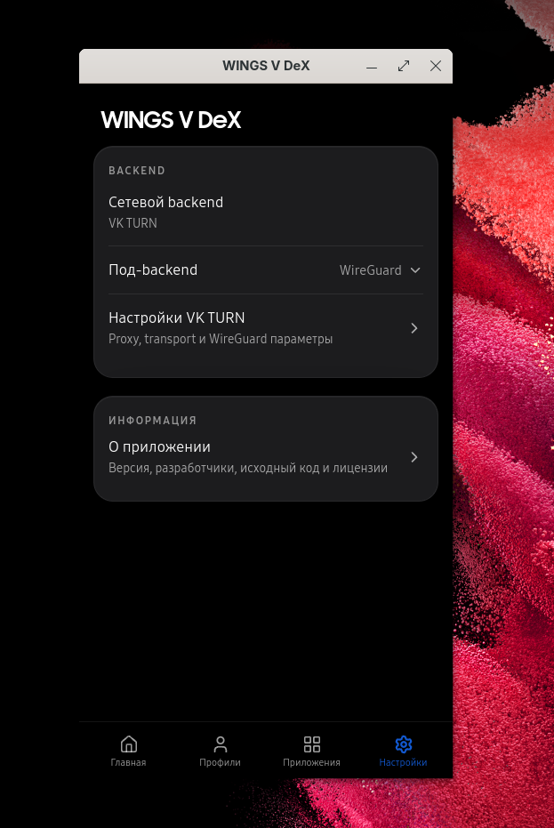
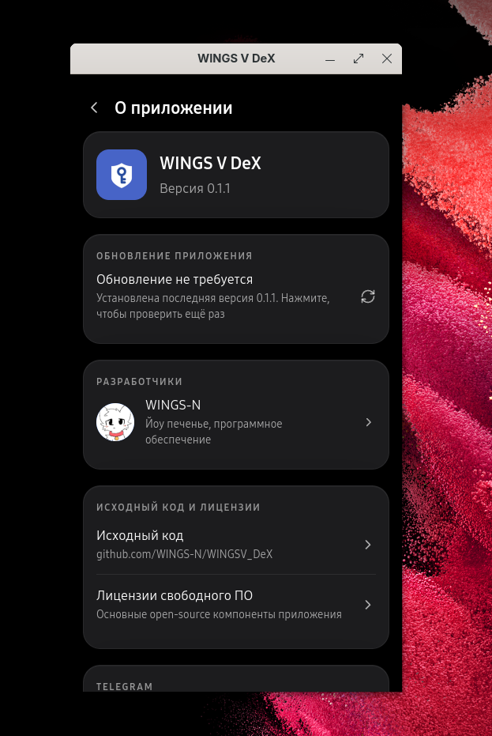

<h1 align="center">WINGS V DeX</h1>

<p align="center">
  <a href="https://github.com/WINGS-N/WINGSV_DeX/releases">
    
  </a>
  <a href="https://t.me/+KrgCVOtwL980ZDky">
    
  </a>
</p>

Настольное приложение для Linux и Windows, которое помогает вернуть привычный интернет там, где его блокируют. Прячет VPN-подключение внутри звонков VK (VK TURN) - для провайдера это выглядит как обычный звонок в VK, а не как VPN. Внутри работает WireGuard.

Это настольная версия клиента [WINGS V для Android](https://github.com/WINGS-N/WINGSV).

## Скриншоты

| | |
| :---: | :---: |
| **Главная** | **Профили** |
|  |  |
| **Маршрутизация приложений** | **Настройки VK TURN** |
|  |  |

<details>
<summary>Показать ещё скриншоты</summary>

| | |
| :---: | :---: |
| **Приветствие** | **Выбор подключения** |
|  |  |
| **Настройки** | **О приложении** |
|  |  |

</details>

## Что умеет

- подключаться одной кнопкой
- добавлять профили по ссылке `wingsv://` из буфера обмена
- входить через `VK ID` или работать анонимно
- маршрутизация по приложениям (**только Linux**): пустить выбранные программы напрямую, мимо VPN (`Bypass`), или наоборот - только их через VPN (`Whitelist`)
- показывать журнал подключения (runtime и proxy) прямо в приложении
- обновляться прямо из приложения
- проводить через короткое приветствие при первом запуске

## Установка

Скачайте версию для своей системы со [страницы релизов](https://github.com/WINGS-N/WINGSV_DeX/releases):

- **Linux** - `.deb` (Debian/Ubuntu), `.AppImage` (для остальных дистрибутивов) или архив `.tar.gz`.
  `.AppImage` и `.tar.gz` рассчитывают на GTK4 и WebKitGTK 6.0 в системе - в большинстве
  дистрибутивов они уже стоят, а если нет, ставятся из штатного репозитория (`gtk4` и
  `webkitgtk-6.0`; в Debian/Ubuntu пакеты называются `libgtk-4-1` и `libwebkitgtk-6.0-4`).
- **Windows** - установщик `...-setup.exe` или переносимая версия в `.zip`

При подключении приложение один раз попросит повышение прав (pkexec на Linux, UAC на Windows) - это нужно, чтобы поднять VPN.

## С чего начать

1. Запустите приложение и пройдите короткое приветствие.
2. Получите ссылку-профиль `wingsv://` (её выдаёт тот, кто раздаёт вам доступ), скопируйте её и нажмите **«Вставить из буфера»**.
3. Нажмите круглую кнопку - готово, вы подключены.

## NixOS (x86_64-linux)

Из исходников соберите пакет и запустите его из любого каталога:

```sh
nix build .
./result/bin/wingsv-dex
```

`nix run .` запускает тот же пакет. Сборка фиксирует Go-модули, pnpm-зависимости и ревизии четырёх сабмодулей; при запуске не требуются исходники, Go, pnpm или загрузка зависимостей. Локальные изменения основного репозитория учитываются flake, если файлы отслеживаются Git. `nix develop .` предоставляет инструменты для ручной разработки; для обычного `task build` в checkout по-прежнему инициализируйте сабмодули (`git submodule update --init --recursive`).

Для подключения VPN на NixOS нужен включённый polkit и стандартный setuid-wrapper `/run/wrappers/bin/pkexec` в `PATH` (например, `security.polkit.enable = true;` в конфигурации системы). Приложение запрашивает пароль только для сетевого помощника; GUI не запускается от root. VPN и авторизацию polkit проверяйте отдельно. Desktop entry обрабатывает `wingsv://` и `vless://`, если пакет установлен в профиль с интеграцией desktop-файлов.

Для запуска в трее после входа в графический сеанс без повторного запроса пароля можно подключить NixOS-модуль:

```nix
{
  inputs.wingsv-dex.url = "path:/path/to/WINGSV_Dex";

  outputs = { nixpkgs, wingsv-dex, ... }: {
    nixosConfigurations.my-host = nixpkgs.lib.nixosSystem {
      system = "x86_64-linux";
      modules = [
        wingsv-dex.nixosModules.default
        {
          services.wingsv-dex = {
            enable = true;
            user = "your-user";
            privilegedHelper.enable = true;
          };
        }
      ];
    };
  };
}
```

Замените путь к checkout, `my-host` и `your-user` на свои значения, добавьте модуль в существующую конфигурацию вместо замены её модулей и примените конфигурацию привычным для вашей системы способом. Автозапуск привязан к `graphical-session.target` выбранного пользователя; профили и авто-подключение настраиваются в приложении этого пользователя. Привилегированный helper выключен по умолчанию: включение даёт указанному пользователю широкие полномочия для управления сетью хоста, поэтому не включайте его для недоверенных учётных записей. GUI остаётся непривилегированным; прежний режим с `pkexec` работает без этой опции. Изолированный тест сокета и запуска helper: `nix build .#checks.x86_64-linux.nethelper --no-link`. Реальное подключение с вашим профилем он не проверяет.

Встроенное самообновление Nix-пакета отключено: обновляйте его средствами Nix. Сборка рассчитана на x86_64-linux; для запуска GUI необходима графическая сессия с GTK4 и WebKitGTK 6.0, предоставляемыми пакетом через nixpkgs.

## Что используется

- `Wails v3` - десктопная оболочка (Go + системный WebView)
- `Vue 3` - интерфейс
- `WireGuard` - VPN-туннель
- `vk-turn-proxy` ([WINGS-N/vk-turn-proxy](https://github.com/WINGS-N/vk-turn-proxy)) - обфускация VK TURN с SRTP-mimicry

## Special thanks to

- [Samsung](https://www.samsung.com/)
- [tribalfs](https://github.com/tribalfs)
- [Yanndroid](https://github.com/Yanndroid)
- [salvogiangri](https://github.com/salvogiangri)
- [zx2c4](https://github.com/zx2c4)
- [cacggghp](https://github.com/cacggghp)
- [Moroka8](https://github.com/Moroka8)
- [samosvalishe](https://github.com/samosvalishe)
- [Amnezia VPN](https://github.com/amnezia-vpn)
